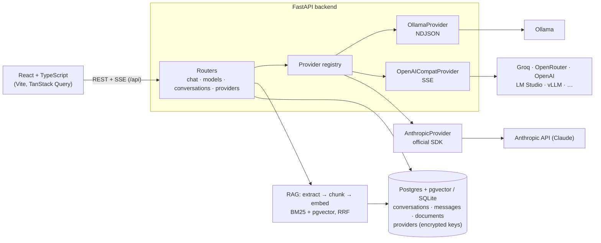

# WebUI Replica

A self-hosted AI chat app that talks to **Ollama**, **Anthropic's Claude** (native API), and **any OpenAI-compatible API** (Groq, OpenRouter, OpenAI, Together, LM Studio, vLLM) from one interface. Replies stream in as they're written, and you can switch providers in the middle of a conversation.

**Live demo: [webui-replica.vercel.app](https://webui-replica.vercel.app)** · runs on Groq's free tier, so Ollama shows as configured but offline (it needs a machine you control). For the full experience, run it locally with `docker compose up`.


## Features

- **Three provider types, one model menu.** Models from every enabled provider are grouped by provider, each with a live health dot.
- **Switch models mid-conversation.** The next message goes to the newly selected model with the full history, and each reply is labelled with the model and provider that wrote it.
- **Streaming with Stop.** Tokens appear as they're generated. Stopping keeps the partial answer.
- **Markdown, code, and math.** GitHub-flavoured Markdown, syntax highlighting with a copy button, and LaTeX formulas (KaTeX loads only for messages that contain math).
- **Work with replies.** Copy, regenerate (optionally with a different model), edit and resend an earlier message, and rate replies 👍/👎 with an optional comment.
- **Per-chat system prompt.** Give a chat standing instructions, even before the first message.
- **Organise and find chats.** Full-text search across titles and messages (with matching snippets), pin, archive and restore.
- **Share and export.** Share a read-only public snapshot by link (later messages stay private until you update it), export a chat as Markdown or JSON, or export every chat at once.
- **Conversation history.** Chats are saved and grouped by date, with auto-titles, inline rename, and delete.
- **Provider settings in the browser.** Add, edit, enable/disable, and delete providers, and test a connection before saving. Presets cover common services.
- **Encrypted API keys.** Keys are encrypted at rest and never sent back to the browser.
- **Chat with your documents (RAG).** Upload PDF, Word, Markdown, text, CSV, JSON or HTML into reusable knowledge bases, or attach files to a single chat. Answers cite numbered sources with file name and page, and you can expand each citation to read the exact passage.
- **Hybrid search.** Keyword ranking (BM25) always runs. Add an embedding model (Ollama or any `/embeddings` API) and semantic vector search joins in, merged with Reciprocal Rank Fusion. Vectors live in Postgres via **pgvector**.
- **Native Claude support.** Uses the official Anthropic SDK, so the system prompt, per-model output limits, and prompt caching work as Claude intends. If a model declines a request, server-side fallback can answer with another Claude model, and the reply is labelled with the model that actually answered.
- **Accounts and roles.** Email/password sign-up (Argon2-hashed), optional "Sign in with GitHub/Google", and admin / user / pending roles. The first account becomes admin. Each user's chats are private.
- **Admin panel.** Approve or remove users, change roles, turn sign-up on or off, and manage providers.
- **Built for a public demo.** Includes an optional guest mode and per-IP rate limits on chat and sign-in.
- **Polish.** Dark mode by default with a light toggle, works at phone widths, and handles empty, loading, and error states.

| Settings | Mobile |
|---|---|
|  |  |

## Architecture



## Tech stack

| Layer | Tools |
|---|---|
| Frontend | React 18, TypeScript, Vite, Tailwind CSS, TanStack Query, React Router, react-markdown + remark-gfm + rehype-highlight |
| Backend | Python 3.11+, FastAPI, httpx (async), SQLModel, Alembic, cryptography (Fernet), pydantic-settings |
| Data | SQLite for local dev, Postgres in Docker and production |
| Infra | Docker, docker compose (frontend · backend · Postgres · Ollama), GitHub Actions, Vercel + Neon for the demo |
| Tests | pytest + respx (mocked provider HTTP), Vitest, Playwright for manual end-to-end checks |

## Run it locally (full experience)

Requires Docker.

```bash
git clone <this repo> && cd webui-replica
cp .env.example .env
# Put an encryption key in .env (needed to store API keys):
sed -i.bak "s|^ENCRYPTION_KEY=.*|ENCRYPTION_KEY=$(openssl rand -base64 32 | tr '+/' '-_')|" .env && rm .env.bak

docker compose up --build
docker compose exec ollama ollama pull qwen2.5:0.5b   # a small model (~400 MB) to start with
```

Open **http://localhost:3000**, then:

- create your account (the first one becomes the admin and keeps any existing chats), then
- add Groq, OpenAI, or another service under **Admin panel → Connections → Add provider**.

If a port is taken, set `FRONTEND_PORT`, `BACKEND_PORT`, or `OLLAMA_PORT` in `.env`. Ollama installed directly on your machine is reachable from the backend container at `http://host.docker.internal:11434`.

## Development without Docker

```bash
# backend: http://localhost:8000 (API docs at /docs)
cd backend
python3 -m venv .venv && .venv/bin/pip install -e '.[dev]'
cp .env.example .env               # set ENCRYPTION_KEY; OLLAMA_BASE_URL if you run Ollama
.venv/bin/uvicorn app.main:app --reload

# frontend: http://localhost:5173 (proxies /api to :8000)
cd frontend
npm install
npm run dev
```

Checks (the same ones CI runs):

```bash
cd backend  && .venv/bin/ruff check . && .venv/bin/ruff format --check . && .venv/bin/pytest
cd frontend && npm run lint && npm run format:check && npm test && npm run build
```

## Configuration

Backend environment variables (see [`backend/.env.example`](backend/.env.example)):

| Variable | Default | Purpose |
|---|---|---|
| `DATABASE_URL` | `sqlite:///./webui.db` | SQLite or Postgres. `postgres://` URLs from hosts like Neon work as-is |
| `ENCRYPTION_KEY` | — | Fernet key for stored API keys. Required to save a provider with a key |
| `FRONTEND_ORIGIN` | `http://localhost:5173` | Allowed CORS origin(s), comma-separated |
| `OLLAMA_BASE_URL`, `OPENAI_COMPAT_BASE_URL`, `OPENAI_COMPAT_API_KEY`, `ANTHROPIC_API_KEY` | — | Providers created on first start, only while the providers table is empty |
| `SECRET_KEY` | derived from `ENCRYPTION_KEY` | Signs session cookies |
| `ENABLE_SIGNUP` | `true` | Initial value; admins can change it in the admin panel |
| `DEFAULT_USER_ROLE` | `pending` | Role for new sign-ups: `pending` (admin approves) or `user`. Admins can change it |
| `ADMIN_EMAIL`, `ADMIN_PASSWORD`, `ADMIN_NAME` | — | Creates this admin on startup/deploy, so a public site isn't claimed by whoever signs up first |
| `GUEST_ACCESS` | `false` | Shows "Continue as guest" (a throwaway account per visitor) |
| `GITHUB_CLIENT_ID`/`_SECRET`, `GOOGLE_CLIENT_ID`/`_SECRET`, `PUBLIC_URL` | — | Sign in with GitHub/Google. Register `<PUBLIC_URL>/api/auth/oauth/<provider>/callback` |
| `AUTH_RATE_LIMIT_PER_MINUTE` | `10` | Sign-up/login/guest attempts per minute per IP |
| `MAX_UPLOAD_MB` | `10` | Largest document upload (use `4` on Vercel, which caps request bodies at 4.5 MB) |
| `RAG_EMBEDDING_ENGINE`, `RAG_EMBEDDING_BASE_URL`, `RAG_EMBEDDING_MODEL`, `RAG_EMBEDDING_API_KEY` | — | Initial semantic-search settings: engine `ollama` or `openai` (any `/embeddings` API); blank means keyword search only. Admins can change them under Admin panel → Documents |
| `DEFAULT_MODEL` | — | Model new visitors start with, e.g. `groq:openai/gpt-oss-120b` |
| `CHAT_RATE_LIMIT_PER_MINUTE` | `20` | Messages per minute per client IP. `0` disables the limit |
| `TRUSTED_PROXY_HOPS` | `0` | Number of proxies whose `X-Forwarded-For` entries are trusted (1 behind nginx or Vercel) |
| `AUTO_MIGRATE` | `true` | Run migrations on startup. Vercel runs them during the build instead |

## Deployment

The public demo runs as **one Vercel project** (React frontend and FastAPI backend on the same domain), with **Neon** Postgres and **Groq** as the model provider. The step-by-step guide is in [docs/deploy-vercel.md](docs/deploy-vercel.md).

The Docker images also run on any container host (Render, Railway, Fly.io). Set `VITE_API_URL` when building the frontend if the API is on a different domain.

## Design decisions

- **Provider abstraction.** Ollama, OpenAI-compatible APIs, and Anthropic implement the same small interface: `list_models`, `stream_chat`, and `health`. Each provider turns its wire format (Ollama's NDJSON, OpenAI's SSE with a `[DONE]` terminator, Anthropic's typed stream events via the official SDK) into the same text deltas plus one final chunk with token usage. Supporting another kind of API means adding one class.
- **Namespaced model IDs.** The frontend sees models as `provider_id:model`, so two providers can offer a model with the same name. The ID is split on the *first* colon because Ollama tags contain colons: `ollama:llama3.2:1b` → provider `ollama`, model `llama3.2:1b`.
- **One normalized stream.** The browser only ever receives `data: {"delta": …}`, then `{"done": true, "usage": …}` or `{"error": …}`. The user's message is saved before the model is called. The reply is saved however the stream ends — when it finishes, when the provider fails, or when the user presses Stop — so partial answers survive a refresh.
- **Encrypted keys.** API keys are encrypted with Fernet before they're stored. The API only reports `has_key`. If a stored key can't be decrypted, only that provider shows as broken; the rest keep working.
- **Registry that follows the database.** Each request re-reads the enabled providers and rebuilds only the ones whose settings changed, so edits made in Settings apply immediately.
- **Retrieval that degrades gracefully.** Keyword search needs no model, so documents are always searchable. If embedding a document fails, it's still indexed for keywords, with a visible note. If embedding a question fails, the search falls back to keywords. Each chunk records which embedding model produced it, so vectors from different models are never compared, and a re-index button re-embeds everything after a model change.
- **Citations people can check.** Chunks never span pages, so every source points at one page. The passages are sent to the model with numbered tags and an instruction to cite them, and the same passages are saved with the reply, so the citations still match after a refresh. Weak matches are cut relative to the best one (BM25 under 40% of the top score; vectors more than 0.10 cosine below the best), so answers don't cite every loosely related file.
- **Refusals are not answers.** When Claude declines, the partial text is discarded rather than saved, and the user sees why. On Anthropic's API the newest models opt into server-side fallback (`fallbacks: "default"`), so most declines are answered by another Claude model on the same stream.
- **Accounts without a session store.** A signed JWT in an HttpOnly, SameSite=Lax cookie identifies the user, so any serverless instance can verify it without shared memory. The token carries a per-user `session_version`: changing a password bumps it and signs out every other device. Roles are read from the database on each request, so approving, demoting, or deleting a user takes effect immediately. Login uses the same error and timing for unknown emails as for wrong passwords, so it doesn't reveal which accounts exist.
- **Admin-only provider settings.** Provider URLs and keys, and the connection-test endpoint (which makes the server call a URL), are restricted to admins. Other users only see the model list.
- **A demo you can safely make public.** The admin account is created from env vars at deploy time, so a stranger can't claim the site by signing up first. The rate limits count hits in the database, so they hold across serverless instances, and use only the `X-Forwarded-For` entries added by trusted proxies, so clients can't forge their IP to dodge them.
- **Vercel instead of a separate backend host.** Vercel runs FastAPI with streaming and lifespan support, and serves the built frontend from its CDN on the same domain. That avoids CORS and the 30–60 s cold start of a sleeping free container. Migrations and seeding run once per deploy instead of on every cold start.

## Project structure

```
backend/   FastAPI app (app/), providers (app/providers/), routers (app/routers/),
           Alembic migrations, tests, Dockerfile, Vercel config
frontend/  React app: api/ (typed client + SSE reader), components/, hooks/, pages/,
           nginx.conf and Dockerfile for the container image
docs/      Deployment guide and README images
```

## Credits

Inspired by [Open WebUI](https://github.com/open-webui/open-webui); independent implementation in React + FastAPI. No code, assets, or branding are taken from Open WebUI.
