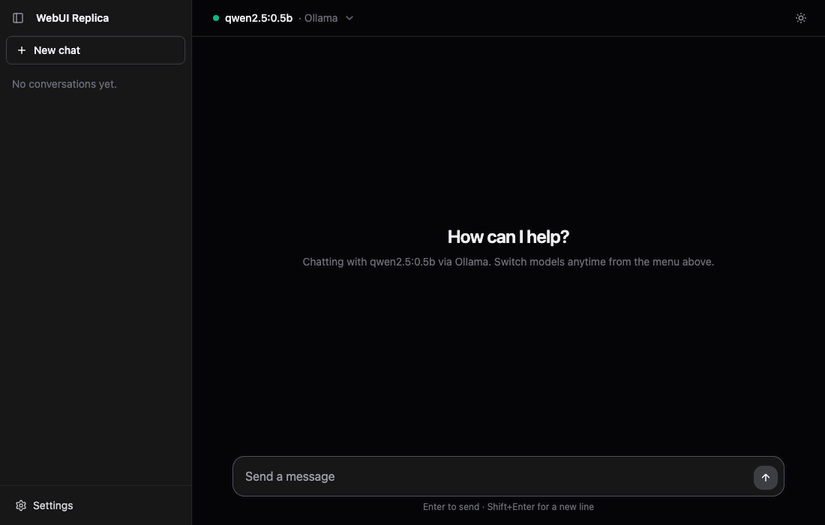
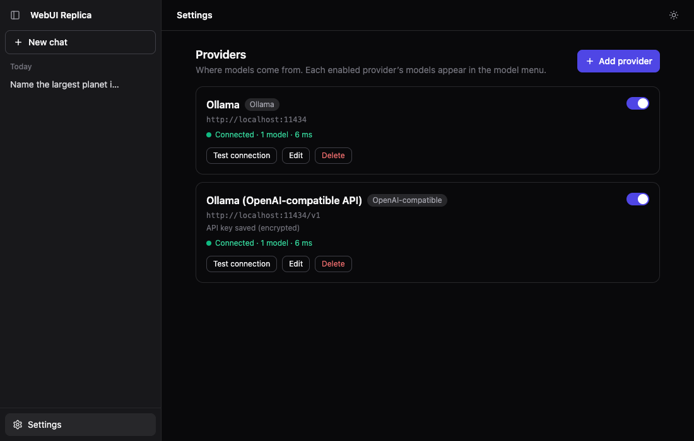
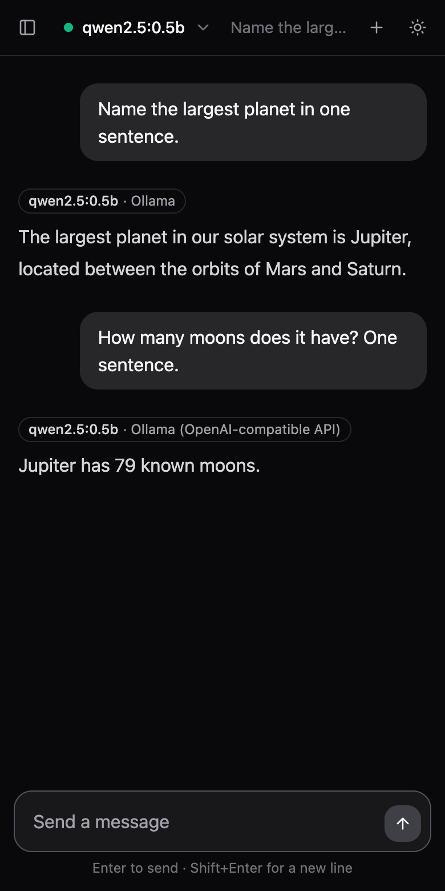
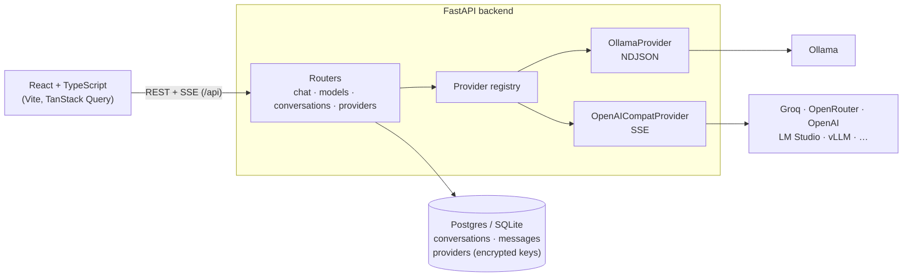

# WebUI Replica

A self-hosted AI chat app that talks to **Ollama** and **any OpenAI-compatible API** (Groq, OpenRouter, OpenAI, Together, LM Studio, vLLM) from one interface. Replies stream in as they're written, and you can switch providers in the middle of a conversation.

**Live demo:** _coming soon_ · runs on Groq's free tier, so Ollama shows as configured but offline (it needs a machine you control). For the full experience, run it locally with `docker compose up`.



## Features

- **Two provider types, one model menu.** Models from every enabled provider are grouped by provider, each with a live health dot.
- **Switch models mid-conversation.** The next message goes to the newly selected model with the full history, and each reply is labelled with the model and provider that wrote it.
- **Streaming with Stop.** Tokens appear as they're generated. Stopping keeps the partial answer.
- **Markdown and code.** GitHub-flavoured Markdown, syntax highlighting, and a copy button on code blocks.
- **Conversation history.** Chats are saved and grouped by date, with auto-titles, inline rename, and delete.
- **Provider settings in the browser.** Add, edit, enable/disable, and delete providers, and test a connection before saving. Presets cover common services.
- **Encrypted API keys.** Keys are encrypted at rest and never sent back to the browser.
- **Built for a public demo.** Includes a per-IP rate limit and a read-only provider mode.
- **Polish.** Dark mode by default with a light toggle, works at phone widths, and handles empty, loading, and error states.

| Settings | Mobile |
|---|---|
|  |  |

## Architecture



## Tech stack

| Layer | Tools |
|---|---|
| Frontend | React 18, TypeScript, Vite, Tailwind CSS, TanStack Query, React Router, react-markdown + remark-gfm + rehype-highlight |
| Backend | Python 3.11+, FastAPI, httpx (async), SQLModel, Alembic, cryptography (Fernet), pydantic-settings |
| Data | SQLite for local dev, Postgres in Docker and production |
| Infra | Docker, docker compose (frontend · backend · Postgres · Ollama), GitHub Actions, Vercel + Neon for the demo |
| Tests | pytest + respx (mocked provider HTTP), Vitest, Playwright for manual end-to-end checks |

## Run it locally (full experience)

Requires Docker.

```bash
git clone <this repo> && cd webui-replica
cp .env.example .env
# Put an encryption key in .env (needed to store API keys):
sed -i.bak "s|^ENCRYPTION_KEY=.*|ENCRYPTION_KEY=$(openssl rand -base64 32 | tr '+/' '-_')|" .env && rm .env.bak

docker compose up --build
docker compose exec ollama ollama pull qwen2.5:0.5b   # a small model (~400 MB) to start with
```

Open **http://localhost:3000**, then:

- chat with the Ollama model straight away, and
- add Groq, OpenAI, or another service under **Settings → Add provider**.

If a port is taken, set `FRONTEND_PORT`, `BACKEND_PORT`, or `OLLAMA_PORT` in `.env`. Ollama installed directly on your machine is reachable from the backend container at `http://host.docker.internal:11434`.

## Development without Docker

```bash
# backend: http://localhost:8000 (API docs at /docs)
cd backend
python3 -m venv .venv && .venv/bin/pip install -e '.[dev]'
cp .env.example .env               # set ENCRYPTION_KEY; OLLAMA_BASE_URL if you run Ollama
.venv/bin/uvicorn app.main:app --reload

# frontend: http://localhost:5173 (proxies /api to :8000)
cd frontend
npm install
npm run dev
```

Checks (the same ones CI runs):

```bash
cd backend  && .venv/bin/ruff check . && .venv/bin/ruff format --check . && .venv/bin/pytest
cd frontend && npm run lint && npm run format:check && npm test && npm run build
```

## Configuration

Backend environment variables (see [`backend/.env.example`](backend/.env.example)):

| Variable | Default | Purpose |
|---|---|---|
| `DATABASE_URL` | `sqlite:///./webui.db` | SQLite or Postgres. `postgres://` URLs from hosts like Neon work as-is |
| `ENCRYPTION_KEY` | — | Fernet key for stored API keys. Required to save a provider with a key |
| `FRONTEND_ORIGIN` | `http://localhost:5173` | Allowed CORS origin(s), comma-separated |
| `OLLAMA_BASE_URL`, `OPENAI_COMPAT_BASE_URL`, `OPENAI_COMPAT_API_KEY` | — | Providers created on first start, only while the providers table is empty |
| `PROVIDERS_READ_ONLY` | `false` | Blocks provider changes. Use on public deployments, since there is no login |
| `CHAT_RATE_LIMIT_PER_MINUTE` | `20` | Messages per minute per client IP. `0` disables the limit |
| `TRUSTED_PROXY_HOPS` | `0` | Number of proxies whose `X-Forwarded-For` entries are trusted (1 behind nginx or Vercel) |
| `AUTO_MIGRATE` | `true` | Run migrations on startup. Vercel runs them during the build instead |

## Deployment

The public demo runs as **one Vercel project** (React frontend and FastAPI backend on the same domain), with **Neon** Postgres and **Groq** as the model provider. The step-by-step guide is in [docs/deploy-vercel.md](docs/deploy-vercel.md).

The Docker images also run on any container host (Render, Railway, Fly.io). Set `VITE_API_URL` when building the frontend if the API is on a different domain.

## Design decisions

- **Provider abstraction.** Ollama and OpenAI-compatible APIs implement the same small interface: `list_models`, `stream_chat`, and `health`. Each provider turns its wire format (Ollama's NDJSON, OpenAI's SSE with a `[DONE]` terminator) into the same text deltas plus one final chunk with token usage. Supporting another kind of API means adding one class.
- **Namespaced model IDs.** The frontend sees models as `provider_id:model`, so two providers can offer a model with the same name. The ID is split on the *first* colon because Ollama tags contain colons: `ollama:llama3.2:1b` → provider `ollama`, model `llama3.2:1b`.
- **One normalized stream.** The browser only ever receives `data: {"delta": …}`, then `{"done": true, "usage": …}` or `{"error": …}`. The user's message is saved before the model is called. The reply is saved however the stream ends — when it finishes, when the provider fails, or when the user presses Stop — so partial answers survive a refresh.
- **Encrypted keys.** API keys are encrypted with Fernet before they're stored. The API only reports `has_key`. If a stored key can't be decrypted, only that provider shows as broken; the rest keep working.
- **Registry that follows the database.** Each request re-reads the enabled providers and rebuilds only the ones whose settings changed, so edits made in Settings apply immediately.
- **A demo you can safely make public.** The app has no login, so `PROVIDERS_READ_ONLY` locks provider changes (and the connection-test endpoint, which could otherwise make the server call any URL). The rate limit counts hits in the database, so it holds across serverless instances. It uses only the `X-Forwarded-For` entries added by trusted proxies, so clients can't forge their IP to dodge the limit.
- **Vercel instead of a separate backend host.** Vercel runs FastAPI with streaming and lifespan support, and serves the built frontend from its CDN on the same domain. That avoids CORS and the 30–60 s cold start of a sleeping free container. Migrations and seeding run once per deploy instead of on every cold start.

## Project structure

```
backend/   FastAPI app (app/), providers (app/providers/), routers (app/routers/),
           Alembic migrations, tests, Dockerfile, Vercel config
frontend/  React app: api/ (typed client + SSE reader), components/, hooks/, pages/,
           nginx.conf and Dockerfile for the container image
docs/      Deployment guide and README images
```

## Credits

Inspired by [Open WebUI](https://github.com/open-webui/open-webui); independent implementation in React + FastAPI. No code, assets, or branding are taken from Open WebUI.
